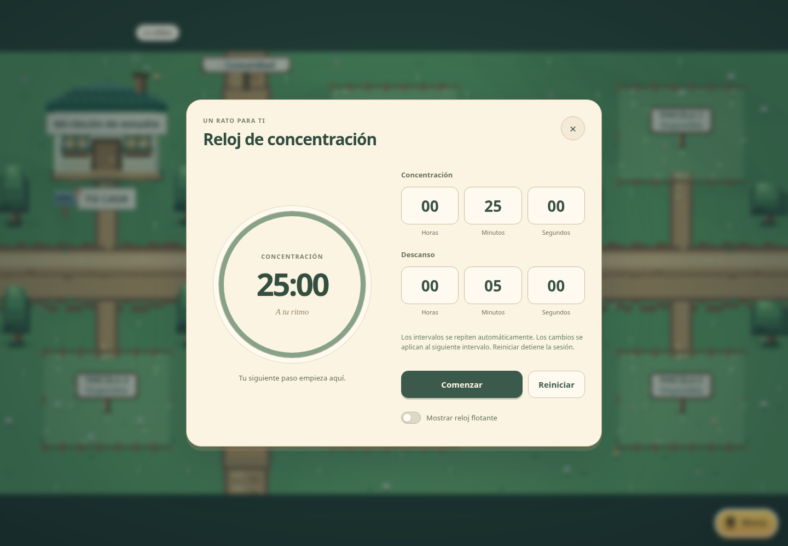
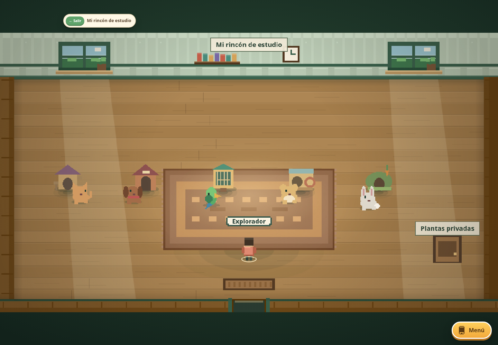

# StudyVillage amendment delivery

This implementation follows the approved plan: no achievements or pet unlock progression; placing a species house creates that pet, removing it removes the pet. Cat, dog, parrot, hamster and rabbit houses share one owner-wide limit of five, including duplicate species. No amphitheater, new voice system or new multiplayer framework is included.

| Item | Implementation and main components | Regression evidence / practical limit |
|---|---|---|
| Completed whiteboard strokes | `app/src/ui/app.ts`, `board-editor.ts`: synchronous local commit before temporary rendering clears; queued network operations; per-stroke rollback; existing pointer buffer/capture/cancellation retained. Removed the editor's busy rejection of a second completed gesture while the first save is pending. | `amendments.spec.ts` drives consecutive immediate releases outside the canvas at DPR 1/2, duplicate lost-capture, undo/redo and reload. `board-pencil.spec.ts` covers the common input lifecycle. Both library and personal boards share this editor. |
| Wardrobe | `wardrobe-ui.ts`, `app.ts`: one idempotent cleanup releases controls and selected furniture on save, cancel, Escape, close, switching interactions and room transitions. Save snapshots survive asynchronous completion. | Existing wardrobe browser checks cover saving, discarding and persistence; repeated Escape, cancel and save exits verify immediate movement and one editor instance, followed by leaving/reentering the room. |
| NPC bubbles | `npc-speech.ts`, `npc-speech-model.ts`, `npc-speech.css`: larger Standard default, Small/Standard/Large, shared viewport-bounded scrollable text, live settings, reset and persistence. Localized message resolved before animation. | Desktop/phone bubble browser tests, preference unit tests; no dialogue-content expansion. |
| Settings, labels and localization | `phone-ui.ts`, shared `world-label.ts`, world/house renderers, ES/EN/FR catalogues. Gear icon; full wrapped furniture, station, room and house labels; French plot/timer wording. | Translation parity check and browser language flows. Full labels are rendered directly, not hidden in hover-only tooltips. |
| Pomodoro | `focus-clock-model.ts`, `focus-clock.ts`: separate configured durations, current phase/status, deadline and paused remainder; automatic focus/rest cycles; reset stops; panel hiding is independent; duration edits apply to later phases. | Model tests cover delayed callbacks and pause/resume; browser check observes two complete cycles while hidden, reset, persisted HUD and translated fields. |
| Pets | `packages/core/src/pets/`, `app/src/pets/`, furniture schemas/models and workspace/server authorities: persistent IDs/modes/names/phrase; five-house aggregate validation; safe spawning; roam, stable follow slots, room transfer and stuck recovery; owner authority and scene-scoped snapshots; paired devices route petting and ability commands to that authority. | `pets.test.ts` plus separate WebSocket-client tests for ownership, routing, cap and disconnect. Inactive areas do not accrue ambient simulation time. Only the primary device simulates; other devices render snapshots. |
| Food, petting, abilities | Same controller: reachable reserved bowls, randomized active-time visits, safe bowl removal, temporary petting, cooldowns. Cat purr, dog fetch, parrot saved text on explicit command, hamster ball, rabbit hop to owner's nearby position. | Controller fixtures cover interruption/resumption and all five abilities. Parrot has no microphone/audio or chat scraping. No score, timer or survival effects. |
| Pet game bots | Werewolves role-view policy and Forest Blocks' existing legal-move evaluator; shared reservations across both engines; actions go through existing validators and bounded bot timing. | Eight seeded complete Werewolves matches and a complete Forest Blocks match, cancellation/reservation/ownership fixtures. Removing a participating pet's house cancels its match safely. Disconnect follows each game's leave path. |
| Repository links | `group-projects.ts`, `projects-ui.ts`: supported GitHub repository roots, normalized owner/name, open/edit/remove and persistence. Existing other git-host URL support retained. | Model validation and restore/remove checks. This links a repository; no account authentication, sync, commits, pushes or secrets are added. |
| Onboarding | `app.ts`, `world-expansion-ui.ts`, `ollama-setup-ui.ts`: brief board purposes, optional Ollama explanation, available-plot route to identity settings. | The existing app assigns plots free of charge to saved residents; there is no seller/purchase implementation to invoke. The copy explains actual behavior. |

## Whiteboard diagnosis and platform boundary

The report came from a Mac with unspecified browser, input device and OS version. The owner uses Linux and does not reproduce it. Inspection found a real shared failure: a second completed gesture could be refused while an asynchronous previous commit held the editor busy, after its temporary stroke had been cleared. Batched rapid events reproduce that loss independent of OS. The fix accepts completed gestures synchronously and serializes network work, preserving the existing authoritative pointer buffer and coordinate conversion. There is no Mac-detection branch.

Synthetic pointer and CI macOS results are regression evidence, not a direct retest on the original reporter's unknown configuration. `docs/VERIFICATION.md` records exact candidate/platform/check results and outstanding device limitations.

## Persistence and assets

Pet configuration lives on stable house furniture instances; no per-frame writes. Own-room pet summaries are sent only to their owner so a second device can list and call pets without visiting every room. Room content and credentials are excluded from those summaries. Transient movement/animation/food clocks are not saved. Artwork replacement instructions and fallbacks are in `docs/SPRITES.md`; provenance is in `ASSETS_LICENSES.md`.

## Reviewed layouts

[Phone pet controls](verification/pets-phone.png) use a scrollable panel with visible names, modes and nearby-action feedback.
